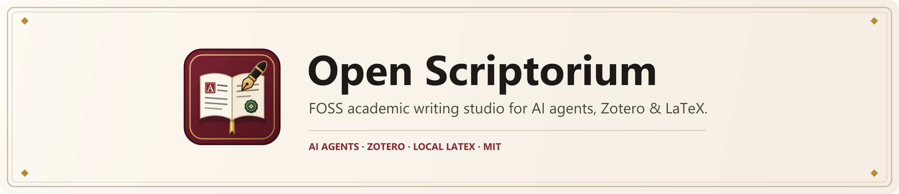

<p align="center">
  
</p>

<p align="center">
  <a href="https://marketplace.visualstudio.com/items?itemName=stevieTheTurtle.open-scriptorium"></a>
  <a href="https://open-vsx.org/extension/stevieTheTurtle/open-scriptorium"></a>
  <a href="https://github.com/stevieTheTurtle/open-scriptorium/releases/latest"></a>
  <a href="LICENSE"></a>
</p>

<p align="center">
  <strong>FOSS academic research &amp; writing studio uniting your AI agent, Zotero library, and local LaTeX workflow in one extension.</strong><br/>
  For VS Code &amp; Antigravity IDE · 100% local · Zero telemetry
</p>

<p align="center">
  <a href="#quick-start">Quick Start</a> ·
  <a href="SETUP.md">Setup Guide</a> ·
  <a href="docs/REFERENCE.md">Settings &amp; Shortcuts</a> ·
  <a href="docs/DEVELOPMENT.md">Development</a>
</p>

---

## Everything in One Studio

- **Built for AI-assisted research** — Connects Antigravity, Claude Code, and VS Code directly to your papers via a fast local `ra` CLI, opt-in [MCP](https://modelcontextprotocol.io/) server, and citation-evidence rules so agents never hallucinate references.
- **Zotero-grounded citations** — Syncs your [Zotero](https://www.zotero.org/) PDFs read-only and verifies every citation in the PDF (verified with verbatim quote + page tooltips, second-hand, or unverified).
- **Find supporting citations (`Ctrl+Alt+C`)** — Highlight any claim to search and locally rerank your library, then insert `\cite{...}` with verbatim evidence in one click.
- **Bundled local LaTeX studio** — Auto-installs [Tectonic](https://tectonic-typesetting.github.io/) on first compile, with Problems-panel diagnostics, `\cite`/`\ref` completion, and flicker-free rebuilds.
- **Native PDF preview & exact-word SyncTeX** — Offline PDF.js tab with outline, in-PDF search (`Ctrl+F`), `Ctrl+Click` hyperlinks, and two-way source jump.
- **Private by design** — Your PDFs, vector index, and Zotero sync stay local; Tectonic always runs with `--untrusted`.

## Quick Start

1. **Install** from the [VS Code Marketplace](https://marketplace.visualstudio.com/items?itemName=stevieTheTurtle.open-scriptorium), [Open VSX](https://open-vsx.org/extension/stevieTheTurtle/open-scriptorium), or [GitHub Releases](https://github.com/stevieTheTurtle/open-scriptorium/releases):
   ```bash
   code --install-extension stevieTheTurtle.open-scriptorium
   ```
2. **Compile & preview** — Open any `.tex` file and press `Ctrl+Enter` (`Cmd+Enter` on macOS). Tectonic installs automatically on first use.
3. **Connect Zotero & AI agents** *(optional, Python 3.10+)* — Run **`Open Scriptorium: Research Assistant: Set Up / Configure`** from the Command Palette.

## Essential Shortcuts

| Shortcut | Action |
|---|---|
| `Ctrl+Enter` | Compile & open PDF preview |
| `Ctrl+Alt+Right` / `Left` | SyncTeX jump *(or double-click a word in the PDF)* |
| `Ctrl+Alt+C` | Find supporting citation in Zotero |
| `Ctrl+F` | Search inside PDF |

*On macOS, use `Cmd` instead of `Ctrl`. See [docs/REFERENCE.md](docs/REFERENCE.md) for all shortcuts and settings.*

## Documentation

- **[SETUP.md](SETUP.md)** — Complete setup for users & AI agents, Zotero sync, shared multi-PC indexes, and troubleshooting.
- **[docs/REFERENCE.md](docs/REFERENCE.md)** — Full settings table, shortcuts, citation verification states, and `ra` CLI commands.
- **[docs/DEVELOPMENT.md](docs/DEVELOPMENT.md)** — Architecture diagram, build & E2E tests, repository map, security, and roadmap.
- **[CHANGELOG.md](CHANGELOG.md)** — Release history.

## License

[MIT](LICENSE) · Bundles [PDF.js](https://github.com/mozilla/pdf.js) (Apache-2.0); integrates with [Tectonic](https://tectonic-typesetting.github.io/) (MIT) and [Zotero](https://www.zotero.org/) (AGPL-3.0).
