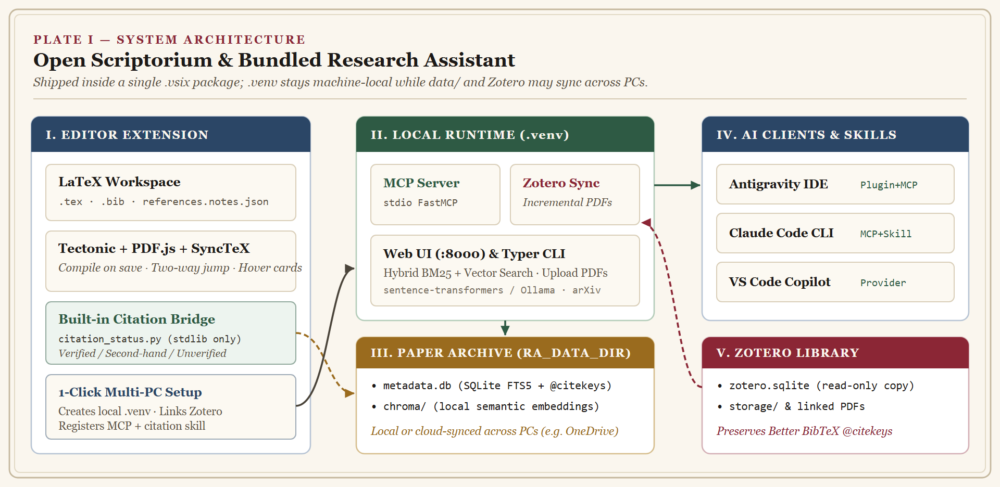
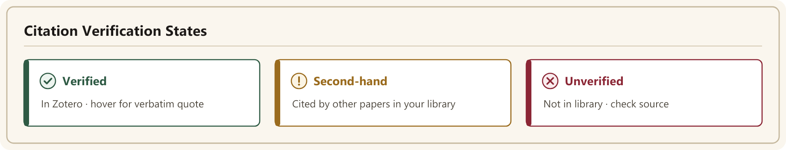

<p align="center">
  
</p>

# Open LaTeX Studio

A local LaTeX writing studio for **VS Code** and **Antigravity IDE** with a bundled **Research Assistant** — combining [Tectonic](https://tectonic-typesetting.github.io/) compilation, side-by-side PDF.js preview with exact-word SyncTeX, [Zotero](https://www.zotero.org/) library sync, a local [Model Context Protocol (MCP)](https://modelcontextprotocol.io/) paper knowledge base, and verbatim citation verification.

> **New PC or AI Agent setting this up?** Read the complete end-to-end guide in **[SETUP.md](SETUP.md)** — it covers installing Open LaTeX Studio in VS Code / Antigravity, connecting [Zotero](https://www.zotero.org/) (with [Better BibTeX](https://retorque.re/zotero-better-bibtex/) `@citekey` support), configuring the bundled Research Assistant MCP server, sharing your paper index across PCs, and both 1-click GUI and headless CLI/agent setup.

## Architecture

<p align="center">
  
</p>

## Citation Verification at a Glance

<p align="center">
  
</p>

## Features

**Bundled Research Assistant (MCP + Zotero + Citation Evidence)**

- **Built-in [Zotero](https://www.zotero.org/) integration**: incrementally indexes PDF attachments (imported or linked) from a read-only snapshot of `zotero.sqlite` — preserving titles, authors, collections, tags, and [Better BibTeX](https://retorque.re/zotero-better-bibtex/) `@citekey` tags without ever locking or modifying your Zotero database. Supports on-demand sync or a background timer (`openLatexStudio.researchAssistant.zoteroSyncIntervalMinutes`).
- **Local [MCP](https://modelcontextprotocol.io/) paper knowledge base**: ships the full Research Assistant Python package (`research-assistant/` — hybrid SQLite FTS5 + ChromaDB semantic search via offline `sentence-transformers` or [Ollama](https://ollama.com/), plus optional arXiv search) and `citation-evidence` agent skill/rules (`agent-plugin/`).
- **1-click multi-PC setup**: run `Open LaTeX Studio: Research Assistant: Set Up / Configure` from the Command Palette on any new PC. It creates a stable `~/.open-latex-studio/research-assistant/.venv`, connects to a local or cloud-synced `data/` index (e.g. OneDrive) and [Zotero](https://www.zotero.org/), and automatically registers:
  - **Antigravity IDE** plugin (`~/.gemini/config/plugins/open-latex-studio-research/` — MCP server + `citation-evidence` skill + always-on rules + logo)
  - **Claude Code CLI** (`~/.claude.json` user MCP server + `~/.claude/skills/citation-evidence/SKILL.md`)
  - **VS Code** (`mcpServerDefinitionProviders` + user `mcp.json`)
- **Automatic PDF citation verification**: a stdlib-only citation bridge matches `.bib` entries against your Zotero index and highlights citations in the PDF preview — **Verified** (with verbatim quote + page tooltips from `references.notes.json`), **Second-hand (yellow)** with extracted citing phrases from papers in your library, and **Unverified (red)**.
- **Local Web UI & CLI**: launch the Research Assistant Web UI (`http://127.0.0.1:8000`) directly from the Command Palette or LaTeX toolbar to upload PDFs, browse collections, edit tags, and test queries.

**Compile**

- Compiles on save, while you type, or only on request with [Tectonic](https://tectonic-typesetting.github.io/).
- One build at a time. Anything you ask for during a build is merged into a single follow-up, so no change is lost.
- A failed build keeps the last good PDF on screen.
- Errors, warnings and bad boxes appear in the Problems panel, on the right file and line. Warnings from inside packages stay in the log.

**PDF preview**

- Opens as a normal editor tab beside your source.
- Keeps your reading position across recompiles, without flashing an empty page.
- Follows VS Code's theme and works offline: PDF.js ships inside the extension.

**Two-way SyncTeX**

- From source to PDF: highlights the typeset line for your cursor, even inside a long paragraph.
- From PDF to source: double-click a word to select that same word in the source.
- Written in TypeScript, so no `synctex` binary is needed.

**Writing help**

- Completion for `\cite`, `\ref` and `\begin`. Citations show author and year, and you can search by key, author or title.
- Outline and breadcrumbs, nested by heading level.
- Word count for the current file in the status bar, and a file-by-file report for the whole document. Text inside commands like `\textbf` counts; math and references do not.
- Insert commands for bold, italic, math, citations, references, figures, tables and lists, plus a dedicated **Research Assistant** menu on the LaTeX editor toolbar.

## Getting started

For full setup instructions (including Research Assistant MCP, Zotero sync, Antigravity IDE plugin, Claude Code, VS Code MCP, and multi-PC setup for humans or AI agents), see **[SETUP.md](SETUP.md)**.

### Quick start

You need:

- VS Code 1.99+ or Antigravity IDE
- [Tectonic](https://tectonic-typesetting.github.io/book/latest/installation/), on your `PATH` or set in `openLatexStudio.tectonicPath`
- Python 3.10+ (for the bundled Research Assistant MCP & citation verification)
- [Zotero](https://www.zotero.org/) *(optional, recommended — with [Better BibTeX](https://retorque.re/zotero-better-bibtex/) for `@citekey` matching)*
- [Node.js](https://nodejs.org/) LTS *(only if building the `.vsix` from source)*

Install the latest `.vsix` from **[Releases](https://github.com/stevieTheTurtle/open-latex-studio/releases)** (or build from source below):

```bash
git clone https://github.com/stevieTheTurtle/open-latex-studio.git
cd open-latex-studio
npm ci
npm run build
npx --yes @vscode/vsce package --no-dependencies
```

Install `open-latex-studio-0.1.0.vsix` via **Extensions → `...` → Install from VSIX...** (or `code --install-extension open-latex-studio-0.1.0.vsix`), then:

1. Open a `.tex` file and press `Ctrl+Enter` (`Cmd+Enter` on macOS) to compile and preview.
2. Run **`Open LaTeX Studio: Research Assistant: Set Up / Configure`** from the Command Palette to create `~/.open-latex-studio/research-assistant/.venv`, connect your paper index & Zotero library, and register the MCP server + citation-evidence skill across Antigravity IDE, Claude Code, and VS Code.

## Keyboard shortcuts

| Shortcut | Action | Where |
|---|---|---|
| `Ctrl+Enter` | Compile | LaTeX file or PDF tab |
| `Ctrl+Alt+Right` | Go to this location in the PDF | LaTeX file |
| `Ctrl+Alt+Left` | Go to this location in the source | PDF tab |
| Double-click | Go to this word in the source | PDF tab |
| `Ctrl+B` / `Ctrl+I` | Bold / italic | LaTeX file |
| `Ctrl+Scroll` | Zoom | PDF tab |

On macOS, use `Cmd` in place of `Ctrl`. All commands are also in the Command Palette under **Open LaTeX Studio**.

## Settings

| Setting | Default | Description |
|---|---|---|
| `openLatexStudio.mainFile` | *(empty)* | Document to compile, relative to the workspace folder |
| `openLatexStudio.outDir` | `.latex-studio/build` | Folder for the PDF and SyncTeX files |
| `openLatexStudio.copyPdfTo` | *(empty)* | Also copy the PDF here after a successful build |
| `openLatexStudio.tectonicPath` | *(empty)* | Tectonic executable; empty means look on `PATH` |
| `openLatexStudio.compile.trigger` | `save` | `save`, `typing` or `off` |
| `openLatexStudio.compile.typingDelayMs` | `2800` | Wait after the last keystroke in `typing` mode |
| `openLatexStudio.languageFeatures.enabled` | `true` | Completion and outline; turn off if another LaTeX extension provides them |
| `openLatexStudio.formatKeybindings` | `true` | `Ctrl+B` and `Ctrl+I` in LaTeX files, which replace the sidebar and inline chat shortcuts there |
| `openLatexStudio.citations.notesFile` | *(empty)* | Path to a citation evidence notes JSON file (e.g. `01_Thesis_meta/references.notes.json`) |
| `openLatexStudio.citations.statusFile` | *(empty)* | Path to citation status JSON (defaults to `<outDir>/citation_status.json`) |
| `openLatexStudio.citations.statusCommand` | *(empty)* | Optional custom command to refresh citation status (empty uses the bundled Research Assistant bridge) |
| `openLatexStudio.researchAssistant.enabled` | `true` | Enable bundled Research Assistant citation checks, MCP provider, and Zotero sync |
| `openLatexStudio.researchAssistant.installDir` | *(empty)* | Stable install folder for Research Assistant (defaults to `~/.open-latex-studio/research-assistant`) |
| `openLatexStudio.researchAssistant.dataDir` | *(empty)* | Research Assistant `data/` folder (auto-detects OneDrive or `<installDir>/data`) |
| `openLatexStudio.researchAssistant.zoteroDir` | *(empty)* | Zotero folder containing `zotero.sqlite` (auto-detected if empty) |
| `openLatexStudio.researchAssistant.collection` | `Zotero` | Collection name used for citation verification and Zotero sync |
| `openLatexStudio.researchAssistant.zoteroSyncIntervalMinutes` | `0` | Periodic background Zotero sync interval in minutes (`0` = manual only) |
| `openLatexStudio.researchAssistant.webUiPort` | `8000` | Port for the Research Assistant Web UI |

If `mainFile` is empty, the document to compile is chosen in this order: a `% !TEX root = ...` comment, the open file if it has `\documentclass`, the last document you compiled, then a search of the workspace.

The default output folder ignores itself in Git, so build files stay out of your repository.

## Security and privacy

- Compiling and Research Assistant scripts only run in [trusted workspaces](https://code.visualstudio.com/docs/editor/workspace-trust). In other workspaces you can still view PDFs.
- Tectonic always runs with `--untrusted`, which keeps shell-escape off whatever the document asks for.
- The PDF preview runs with no open port — it talks to the extension through VS Code's own messaging. The optional Research Assistant Web UI binds to `127.0.0.1` only.
- Your paper index (`metadata.db` and ChromaDB vectors) stays 100% local, and Zotero sync always reads a temporary snapshot copy of `zotero.sqlite` so your live [Zotero](https://www.zotero.org/) database is never locked or modified.
- The extension collects no telemetry. Tectonic downloads TeX packages from its bundle server on demand, and optional arXiv search is disabled until toggled on in the Research Assistant Web UI.

## Roadmap

- [x] Citation evidence: hover a citation in the PDF to see verbatim quotes, second-hand citing phrases, and Zotero verification markers
- [x] Bundled Research Assistant MCP server, Zotero sync, and 1-click multi-PC setup
- [x] Packaged `.vsix` releases
- [ ] Automatic Tectonic installation on first use
- [ ] VS Code Marketplace and Open VSX publishing
- [ ] Full macOS and Linux verification

## Development

```bash
npm run build       # bundle the extension and the viewer into dist/
npm run typecheck   # type-check everything
npm test            # unit tests for parsers, build logic and word count
```

The end-to-end suite opens a real, isolated VS Code window with a throwaway profile and drives compile, preview and SyncTeX on a small test document. On Windows:

```powershell
.\scripts\run-e2e.ps1 -Exe "<path to Code.exe>" -WorkDir "<empty scratch folder>" -Tectonic "<path to tectonic.exe>"
```

| Path | Contents |
|---|---|
| `SETUP.md` | Full end-to-end setup guide for users and AI agents (VS Code, Antigravity, MCP, Zotero) |
| `src/extension.ts` | Activation and commands |
| `src/session.ts`, `src/compile.ts` | Build queue, Tectonic runner, diagnostics |
| `src/project.ts` | Finding the main file and output paths |
| `src/viewer.ts`, `src/webview/` | PDF tab and the PDF.js page inside it |
| `src/synctex.ts`, `src/reveal.ts` | SyncTeX lookups and exact-word matching |
| `src/editing.ts`, `src/latex.ts`, `src/bib.ts` | Completion, outline, word count, insert commands |
| `src/citationService.ts`, `src/citations.ts` | Citation notes, status watcher, and built-in bridge runner |
| `src/researchAssistant.ts`, `src/researchAssistantConfig.ts` | Setup wizard, MCP/plugin registration, Zotero sync, Web UI launcher |
| `research-assistant/` | Bundled Research Assistant Python package (MCP, Zotero sync, Web UI, stdlib `citation_status.py`) |
| `agent-plugin/` | Bundled `citation-evidence` skill & `AGENTS.md` rules |
| `test/` | Unit tests and the end-to-end suite |

The build uses PDF.js's legacy bundle on purpose: the modern one needs browser features missing from the Chromium in older VS Code versions.

## License

[MIT](LICENSE). The extension bundles [PDF.js](https://github.com/mozilla/pdf.js) (Apache-2.0) and the Research Assistant Python package. [Tectonic](https://github.com/tectonic-typesetting/tectonic) (MIT) and [Zotero](https://www.zotero.org/) (AGPL-3.0) are installed separately.
