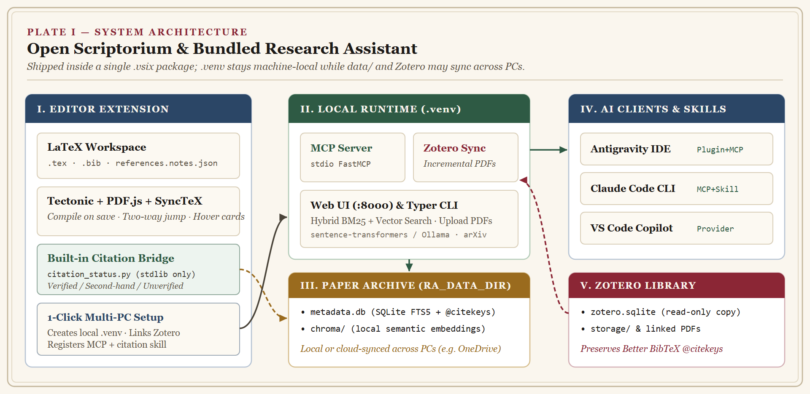
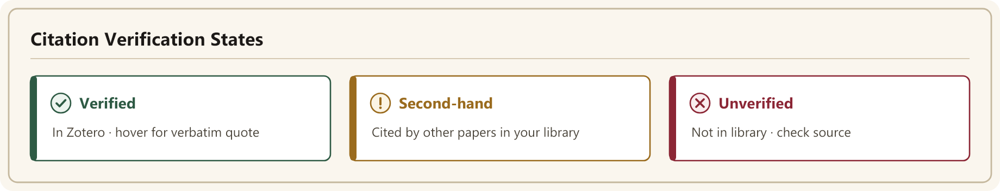

# Open Scriptorium + Research Assistant — Complete Setup Guide (Users & AI Agents)

This guide explains how to set up **everything** in **Open Scriptorium** on a new PC — both interactively (for human users in **VS Code** / **Antigravity IDE**) and non-interactively (for **AI agents** setting up a fresh machine from the terminal).

It covers:
1. The **Open Scriptorium** extension (auto-installed Tectonic LaTeX compiler, PDF.js preview with outline/search/hyperlinks, two-way SyncTeX, citation tooltips).
2. The bundled **Research Assistant** system (local paper RAG database, **low-token `ra` CLI + warm local daemon**, **opt-in MCP fallback server**, **Zotero library sync**, **Web UI / REST API**, **citation status verification**, and **agent citation-evidence skill & rules**).

---

## Architecture Overview

<p align="center">
  
</p>

```text
open-scriptorium (VS Code / Antigravity extension)
├── dist/                      Compiled extension + PDF.js viewer
├── research-assistant/        Bundled Python source (~160 KB; no .venv or data/)
│   ├── core/                  SQLite FTS5 + ChromaDB + sentence-transformers/Ollama
│   ├── mcp_server/            Opt-in stdio FastMCP server (enabled via mcpFallback)
│   ├── api/ & ui/             FastAPI warm daemon + Web UI (http://127.0.0.1:8000)
│   ├── cli/                   CLI-first `ra` tool (`search/detail/list/add/arxiv` + stdlib `notes` & `bib`)
│   └── scripts/
│       ├── zotero_sync.py     Read-only incremental Zotero PDF -> index sync
│       └── citation_status.py Stdlib-only .bib <-> metadata.db citation verifier
└── agent-plugin/
    ├── skills/citation-evidence/SKILL.md
    └── rules/AGENTS.md

Runtime state on each PC (kept outside the extension folder so upgrades never wipe it):
~/.open-scriptorium/research-assistant/
├── .venv/                     Machine-local Python virtual environment (NEVER cloud-sync)
├── config.yaml                Embedding provider (sentence_transformers or ollama) + port
├── ra / ra-ui / ra-mcp / ra-zotero-sync   Launcher scripts
└── data/                      Default index dir (or point RA_DATA_DIR to a shared cloud folder)
    └── collections/
        └── Zotero/
            ├── metadata.db    SQLite papers + chunks + FTS5 full-text index
            └── chroma/        ChromaDB vector embeddings
```

### Key Portability Principle (Multi-PC Setup)
- **Never share `.venv/` across PCs** (OS/Python paths differ). Each PC creates its own `.venv` at `~/.open-scriptorium/research-assistant/.venv`.
- **You CAN share `data/` and Zotero** across PCs (for example via OneDrive, Dropbox, or Syncthing, e.g. `~/OneDrive - <Org>/ZoteroDocuments/ResearchAssistant/data`).
- **CRITICAL if sharing `data/` across PCs:** every PC sharing the same `chroma/` vector store **must use the same embedding provider and model** in `config.yaml` (e.g., all PCs use `ollama` + `nomic-embed-text`, OR all PCs use `sentence_transformers` + `all-MiniLM-L6-v2`). Mixing providers causes vector dimension mismatches unless you re-embed (`scripts/reembed.py`).

---

## Prerequisites (Any PC)

| Tool | Required For | Install |
|---|---|---|
| **VS Code ≥ 1.99** or **Antigravity IDE** | Running the extension | [code.visualstudio.com](https://code.visualstudio.com/) / Antigravity |
| **Tectonic** *(auto-installed)* | Compiling `.tex` to PDF | Installed automatically into `~/.open-scriptorium/bin/` on first compile, or install manually (`winget install Tectonic.Tectonic` / `brew install tectonic`) |
| **Python ≥ 3.10** | Research Assistant + citation status | `winget install Python.Python.3.12` (Win) / `brew install python@3.12` (macOS) |
| **uv** *(optional, recommended)* | 10× faster `.venv` & pip install | `winget install astral-sh.uv` / `curl -LsSf https://astral.sh/uv/install.sh \| sh` |
| **Node.js LTS (≥ 20)** *(only to build from source)* | Building `.vsix` from repo | [nodejs.org](https://nodejs.org/) |
| **Zotero** *(optional)* | Automatic library PDF indexing | [zotero.org](https://www.zotero.org/) (+ Better BibTeX recommended for `@citekey` tags) |
| **Ollama** *(optional)* | Only if using `provider: ollama` | [ollama.com](https://ollama.com/) then `ollama pull nomic-embed-text` |

---

## Part 1: Install Open Scriptorium (VS Code / Antigravity IDE)

### Option A — Install from VS Code Marketplace (recommended)
Search for **Open Scriptorium** (`stevieTheTurtle.open-scriptorium`) in the Extensions view (`Ctrl+Shift+X`), open the [Marketplace listing](https://marketplace.visualstudio.com/items?itemName=stevieTheTurtle.open-scriptorium), or install via CLI:
```bash
code --install-extension stevieTheTurtle.open-scriptorium
```

### Option B — Install from a `.vsix` file
1. Download `open-scriptorium-<version>.vsix` from [GitHub Releases](https://github.com/stevieTheTurtle/open-scriptorium/releases) (or build via Option C).
2. Install it:
   - **GUI (VS Code & Antigravity IDE):** Open the **Extensions** view (`Ctrl+Shift+X`) → click **`...`** (top-right) → **Install from VSIX...** → select `open-scriptorium-<version>.vsix`.
   - **VS Code CLI:**
     ```bash
     code --install-extension /path/to/open-scriptorium-<version>.vsix
     ```

### Option C — Build & package from source
```bash
git clone https://github.com/stevieTheTurtle/open-scriptorium.git
cd open-scriptorium
npm ci
npm run typecheck
npm test
npm run package
```
This produces `open-scriptorium-<version>.vsix` in the repo root. Install it using Option B.

### Configure a LaTeX workspace (`.vscode/settings.json`)
Add only the settings your project needs (all paths are relative to the workspace root):

```json
{
  "openScriptorium.mainFile": "01_Thesis/main.tex",
  "openScriptorium.outDir": ".scriptorium/build",
  "openScriptorium.copyPdfTo": "thesis.pdf",
  "openScriptorium.tectonicPath": "",
  "openScriptorium.compile.trigger": "save",
  "openScriptorium.citations.notesFile": "01_Thesis_meta/references.notes.json"
}
```

- Leave `openScriptorium.tectonicPath` empty to use `tectonic` on `PATH` or let Open Scriptorium auto-install Tectonic into `~/.open-scriptorium/bin/` on first compile (or set an explicit path to `tectonic.exe` / `tectonic`).
- Leave `openScriptorium.citations.statusCommand` **empty** — v0.1.0+ runs the bundled `citation_status.py` bridge automatically whenever a Research Assistant `metadata.db` is detected.
- Open any `.tex` file and press **`Ctrl+Enter`** (`Cmd+Enter` on macOS) to compile and open the PDF preview.

---

## Part 2: Set Up Research Assistant (Interactive 1-Click Wizard — Humans)

Inside **VS Code** or **Antigravity IDE**:

1. Open the Command Palette (`Ctrl+Shift+P` / `Cmd+Shift+P`).
2. Run: **`Open Scriptorium: Research Assistant: Set Up / Configure`**.
3. Follow the 5 quick prompts:
   1. **Python 3.10+**: auto-detected (or browse/enter path).
   2. **Data Directory (`RA_DATA_DIR`)**: auto-detects an existing cloud-synced index (e.g. `OneDrive*/ZoteroDocuments/ResearchAssistant/data`) or lets you pick `~/.open-scriptorium/research-assistant/data` / browse.
   3. **Zotero Folder (`ZOTERO_DIR`)**: auto-detects `zotero.sqlite` in `OneDrive*/ZoteroDocuments` or `~/Zotero` (or browse / skip).
   4. **Embedding Provider**: pick `sentence_transformers` (fully offline, default) or `ollama` (`nomic-embed-text`, pre-filled from an existing `config.yaml` if detected).
   5. **AI Clients to Register**: multi-select any combination of:
      - **Antigravity IDE** — creates the plugin `~/.gemini/config/plugins/open-scriptorium-research/` (`citation-evidence` skill + always-on rules targeting the `ra` CLI, plus `mcp_config.json` when `openScriptorium.researchAssistant.mcpFallback` is enabled)
      - **Claude Code CLI** — installs `~/.claude/skills/citation-evidence/SKILL.md` (and adds `research-assistant` to `~/.claude.json` when `mcpFallback` is enabled)
      - **VS Code** — writes VS Code user `mcp.json` + enables the built-in `mcpServerDefinitionProviders` contribution when `mcpFallback` is enabled
4. Wait for `.venv` creation and dependency installation (first run takes 1–4 min; `uv` makes it much faster).
5. When prompted, click **Sync Zotero Now** (if you use Zotero) and restart Antigravity / Claude Code / VS Code if they were already running so they load the updated plugin/skills.

### Everyday Commands (Command Palette)
- `Open Scriptorium: Research Assistant: Status & Actions` — health check dashboard + quick actions
- `Open Scriptorium: Research Assistant: Sync Zotero Library` — incremental sync of new/updated Zotero PDFs + refreshes PDF citation highlights
- `Open Scriptorium: Research Assistant: Open Web UI` — launches and opens `http://127.0.0.1:8000`
- `Open Scriptorium: Research Assistant: Register MCP & Skills` — re-writes MCP & skill configs without touching `.venv`
- `Open Scriptorium: Research Assistant: Install Citation Rules in Workspace` — copies `.agents/skills/citation-evidence/SKILL.md` and `.agents/rules/citation-evidence.md` into the current repo
- `Open Scriptorium: Refresh Citation Status` — manually re-checks `.bib` entries against `metadata.db`

---

## Part 3: Headless / Scripted Setup (For AI Agents on a New PC)

> **Instructions for AI Agents:** If you are setting up a new machine without clicking VS Code QuickPick dialogs, execute the steps below in order. Replace `<HOME>`, `<EXT_DIR>`, `<DATA_DIR>`, and `<ZOTERO_DIR>` with the machine's actual paths.

### Step 1 — Locate the bundled source
Either from a git clone of `open-scriptorium` or from an installed `.vsix` extension directory:
- Git clone: `<REPO>/research-assistant` and `<REPO>/agent-plugin`
- Installed Antigravity extension: `<HOME>/.antigravity-ide/extensions/stevieTheTurtle.open-scriptorium-*/`
- Installed VS Code extension: `<HOME>/.vscode/extensions/stevieTheTurtle.open-scriptorium-*/`

Set `INSTALL_DIR`:
- Windows: `C:\Users\<USER>\.open-scriptorium\research-assistant`
- macOS/Linux: `$HOME/.open-scriptorium/research-assistant`

### Step 2 — Copy Python source into `INSTALL_DIR` and create `.venv`

**Windows (PowerShell):**
```powershell
$Repo = "C:\path\to\open-scriptorium"
$InstallDir = "$HOME\.open-scriptorium\research-assistant"
New-Item -ItemType Directory -Force -Path $InstallDir | Out-Null
foreach ($sub in @("core","mcp_server","api","cli","ui","scripts")) {
  Copy-Item -Recurse -Force "$Repo\research-assistant\$sub" "$InstallDir\$sub"
}
Copy-Item -Force "$Repo\research-assistant\pyproject.toml" "$InstallDir\pyproject.toml"
Copy-Item -Force "$Repo\research-assistant\config.default.yaml" "$InstallDir\config.default.yaml"

# Create .venv and install dependencies (prefer uv if installed)
if (Get-Command uv -ErrorAction SilentlyContinue) {
  uv venv "$InstallDir\.venv"
  uv pip install --python "$InstallDir\.venv\Scripts\python.exe" -e "$InstallDir"
} else {
  python -m venv "$InstallDir\.venv"
  & "$InstallDir\.venv\Scripts\python.exe" -m pip install -e "$InstallDir"
}
```

**macOS / Linux (Bash):**
```bash
REPO="/path/to/open-scriptorium"
INSTALL_DIR="$HOME/.open-scriptorium/research-assistant"
mkdir -p "$INSTALL_DIR"
for sub in core mcp_server api cli ui scripts; do
  cp -R "$REPO/research-assistant/$sub" "$INSTALL_DIR/$sub"
done
cp "$REPO/research-assistant/pyproject.toml" "$REPO/research-assistant/config.default.yaml" "$INSTALL_DIR/"

if command -v uv >/dev/null 2>&1; then
  uv venv "$INSTALL_DIR/.venv"
  uv pip install --python "$INSTALL_DIR/.venv/bin/python" -e "$INSTALL_DIR"
else
  python3 -m venv "$INSTALL_DIR/.venv"
  "$INSTALL_DIR/.venv/bin/python" -m pip install -e "$INSTALL_DIR"
fi
```

### Step 3 — Write `config.yaml` and initialize the database
Create `$INSTALL_DIR/config.yaml`:

```yaml
embedding:
  # Must match existing shared ChromaDB if reusing data/ across PCs!
  provider: sentence_transformers   # or: ollama
  sentence_transformers:
    model: all-MiniLM-L6-v2
  ollama:
    model: nomic-embed-text
    base_url: http://127.0.0.1:11434

chunking:
  chunk_size: 400
  chunk_overlap: 60

retrieval:
  top_k: 10
  bm25_weight: 0.3
  semantic_weight: 0.7
  rrf_k: 60

api:
  host: 127.0.0.1
  port: 8000

data_dir: "data"
```

Determine `DATA_DIR` and `ZOTERO_DIR`:
- Check if a synced library already exists (e.g. `$HOME/OneDrive*/ZoteroDocuments/ResearchAssistant/data` and `$HOME/OneDrive*/ZoteroDocuments/zotero.sqlite`, or `$HOME/Zotero/zotero.sqlite`).
- If reusing an existing `ResearchAssistant/data`, check for a sibling `config.yaml` and copy its `embedding.provider` and `ollama.base_url` so embeddings stay compatible!
- Initialize the database:
  ```bash
  RA_DATA_DIR="<DATA_DIR>" RA_CONFIG_PATH="<INSTALL_DIR>/config.yaml" PYTHONPATH="<INSTALL_DIR>" \
    "<VENV_PYTHON>" -c "from core.database import init_db; init_db(); print('DB_OK')"
  ```

### Step 4 — Register the MCP Server & Citation-Evidence Skill/Rules

Use these exact env vars for all MCP client registrations:
```json
{
  "RA_DATA_DIR": "<DATA_DIR>",
  "RA_CONFIG_PATH": "<INSTALL_DIR>/config.yaml",
  "ZOTERO_DIR": "<ZOTERO_DIR>",
  "PYTHONPATH": "<INSTALL_DIR>"
}
```
*(Omit `ZOTERO_DIR` if Zotero is not installed on this PC.)*

#### A. Antigravity IDE (Native Plugin — auto-discovered & enabled by default)
Create `<HOME>/.gemini/config/plugins/open-scriptorium-research/` with 4 files:

1. `plugin.json`:
   ```json
   {
     "name": "Open Scriptorium Research Assistant",
     "description": "Local paper library MCP server and citation evidence workflow bundled with Open Scriptorium.",
     "version": "0.1.0",
     "repository": {
       "type": "git",
       "url": "https://github.com/stevieTheTurtle/open-scriptorium.git"
     }
   }
   ```
2. `mcp_config.json`:
   ```json
   {
     "mcpServers": {
       "research-assistant": {
         "command": "<VENV_PYTHON>",
         "args": ["-m", "mcp_server"],
         "env": {
           "RA_DATA_DIR": "<DATA_DIR>",
           "RA_CONFIG_PATH": "<INSTALL_DIR>/config.yaml",
           "ZOTERO_DIR": "<ZOTERO_DIR>",
           "PYTHONPATH": "<INSTALL_DIR>"
         }
       }
     }
   }
   ```
3. `skills/citation-evidence/SKILL.md` — copy from `<REPO>/agent-plugin/skills/citation-evidence/SKILL.md`.
4. `rules/AGENTS.md` — copy from `<REPO>/agent-plugin/rules/AGENTS.md`.

*(Note: Never hand-edit `~/.gemini/config/config.json`; Antigravity auto-discovers plugins in `~/.gemini/config/plugins/`.)*

#### B. Claude Code CLI
1. Merge into `<HOME>/.claude.json` under `mcpServers["research-assistant"]` (**preserve all other keys in `.claude.json`**):
   ```json
   "research-assistant": {
     "type": "stdio",
     "command": "<VENV_PYTHON>",
     "args": ["-m", "mcp_server"],
     "env": {
       "RA_DATA_DIR": "<DATA_DIR>",
       "RA_CONFIG_PATH": "<INSTALL_DIR>/config.yaml",
       "ZOTERO_DIR": "<ZOTERO_DIR>",
       "PYTHONPATH": "<INSTALL_DIR>"
     }
   }
   ```
2. Copy `<REPO>/agent-plugin/skills/citation-evidence/SKILL.md` to `<HOME>/.claude/skills/citation-evidence/SKILL.md`.

#### C. VS Code (User `mcp.json`)
Merge into:
- Windows: `%APPDATA%\Code\User\mcp.json`
- macOS: `~/Library/Application Support/Code/User/mcp.json`
- Linux: `~/.config/Code/User/mcp.json`

Under `servers["research-assistant"]` (**preserve all other keys**):
```json
{
  "servers": {
    "research-assistant": {
      "type": "stdio",
      "command": "<VENV_PYTHON>",
      "args": ["-m", "mcp_server"],
      "env": {
        "RA_DATA_DIR": "<DATA_DIR>",
        "RA_CONFIG_PATH": "<INSTALL_DIR>/config.yaml",
        "ZOTERO_DIR": "<ZOTERO_DIR>",
        "PYTHONPATH": "<INSTALL_DIR>"
      }
    }
  }
}
```
*(In VS Code 1.101+, Open Scriptorium also registers the MCP server automatically via `vscode.lm.registerMcpServerDefinitionProvider`.)*

### Step 5 — Configure VS Code / Antigravity User Settings
In User `settings.json`, set:
```json
{
  "openScriptorium.researchAssistant.enabled": true,
  "openScriptorium.researchAssistant.dataDir": "<DATA_DIR>",
  "openScriptorium.researchAssistant.zoteroDir": "<ZOTERO_DIR>",
  "openScriptorium.researchAssistant.collection": "Zotero",
  "openScriptorium.researchAssistant.zoteroSyncIntervalMinutes": 30
}
```

---

## Part 4: Zotero Sync, Web UI, and Citation Evidence System

### How Zotero Sync Works
- `scripts/zotero_sync.py` copies `zotero.sqlite` (+ `-wal`) into a temporary folder before reading it — it **never locks or modifies your live Zotero database**.
- It indexes every non-trashed PDF attachment (both `storage:` and absolute linked paths) into the `"Zotero"` collection, using Zotero's own title, authors, year, abstract, collections (`coll:...`), tags, and citation key (`@citekey`, e.g. from Better BibTeX / Zotero 8).
- Sync is **incremental**: only new or modified PDFs are re-embedded; deleted Zotero items are removed from the index.
- Run manually:
  ```bash
  RA_DATA_DIR="<DATA_DIR>" RA_CONFIG_PATH="<INSTALL_DIR>/config.yaml" PYTHONPATH="<INSTALL_DIR>" \
    "<VENV_PYTHON>" "<INSTALL_DIR>/scripts/zotero_sync.py" --zotero-dir "<ZOTERO_DIR>" --set-active
  ```
- Run automatically: set `"openScriptorium.researchAssistant.zoteroSyncIntervalMinutes": 30` in VS Code / Antigravity settings (or schedule `ra-zotero-sync.bat` / `ra-zotero-sync` in Windows Task Scheduler / `cron` if you want sync even when the editor is closed).

### How Citation Evidence & Verification Works in the PDF Viewer

<p align="center">
  
</p>

1. **Evidence notes (`references.notes.json`)**:
   Configure `openScriptorium.citations.notesFile` (e.g. `01_Thesis_meta/references.notes.json`) or place `<name>.notes.json` next to `<name>.bib`. Format:
   ```json
   {
     "vaswani2017attention": [
       {
         "quote": "The Transformer is the first transduction model relying entirely on self-attention.",
         "page": 2,
         "file": "chapters/02_background/02_background.tex",
         "claim": "Transformers rely solely on self-attention.",
         "paper_id": "abc123...",
         "added": "2026-11-24"
       }
     ]
   }
   ```
   Hovering a citation in the Open Scriptorium PDF preview displays its metadata plus the verbatim quote and page matching the `.tex` file the citation came from.

2. **Automatic library verification (`citation_status.py`)**:
   - Uses **Python stdlib only** (`sqlite3` read-only — works even without `.venv`).
   - Checks every `.bib` entry against `<dataDir>/collections/<collection>/metadata.db`:
     - **Verified (no warning box)**: matched by `@citekey` tag, normalized title + first author, or title heading inside a proceedings/book PDF (`inside`).
     - **Yellow box (second-hand)**: paper is not in the library, but other indexed papers cite it; the hover popup shows which indexed papers cite it along with extracted verbatim body-text citing phrases.
     - **Red box (unverified)**: nothing in the library mentions the paper.

### Research Assistant Web UI & CLI
- **Web UI**: Run `Open Scriptorium: Research Assistant: Open Web UI` (or `ra-ui.bat` / `./ra-ui`) → `http://127.0.0.1:8000` to drag-drop PDFs, browse collections, edit tags, toggle arXiv search, and test search queries. When `openScriptorium.researchAssistant.autoStartDaemon` is enabled (default), this local service stays warm while a LaTeX workspace is open so CLI queries complete in ~50 ms.
- **REST API** (on the same port): `POST /api/search`, `GET /api/papers`, `GET /api/papers/{id}`, `POST /api/papers/upload`, `DELETE /api/papers/{id}`, `GET /api/health`.
- **CLI (`ra` / `ra.bat`)**:
  - Library: `ra search "query" -k 5 --compact`, `ra search "query" -k 8 --context`, `ra find-support "claim" -k 8`, `ra detail <paper_id>`, `ra list [--tag <tag>] [--year <YYYY>] --compact`, `ra add paper.pdf --tags "a,b"`, `ra status`.
  - Citation evidence & BibTeX (instant stdlib helpers): `ra notes add --key <key> --quote "..." --page <N> --file "<rel.tex>" --claim "..." --paper-id "<id>"`, `ra notes get <key>`, `ra notes audit`, `ra bib get <key>`.
  - Online arXiv (only when requested): `ra arxiv search "query" -n 10`, `ra arxiv fetch <arxiv_id> [--add --tags "..."]`.

---

## Part 5: Verification Checklist (Humans & AI Agents)

Run these checks after setup on a new PC:

1. **Extension builds & tests pass** *(if working from source)*:
   ```bash
   npm run typecheck && npm run build && npm test
   ```
2. **Research Assistant config & DB resolve properly**:
   ```bash
   RA_DATA_DIR="<DATA_DIR>" RA_CONFIG_PATH="<INSTALL_DIR>/config.yaml" PYTHONPATH="<INSTALL_DIR>" \
     "<VENV_PYTHON>" -c "from core.config import get_config; from core.database import list_papers; print(get_config().embedding.provider, len(list_papers()), 'papers')"
   ```
3. **MCP server starts cleanly (no stdout corruption)**:
   ```bash
   RA_DATA_DIR="<DATA_DIR>" RA_CONFIG_PATH="<INSTALL_DIR>/config.yaml" PYTHONPATH="<INSTALL_DIR>" \
     "<VENV_PYTHON>" -c "import mcp_server.server as s; print('MCP_OK', len(s.mcp._tool_manager._tools), 'tools')"
   ```
4. **Standalone citation status script works**:
   ```bash
   python "<INSTALL_DIR>/scripts/citation_status.py" \
     --bib-dir "<LATEX_MAIN_DIR>" \
     --db "<DATA_DIR>/collections/Zotero/metadata.db" \
     --output "<OUT_DIR>/citation_status.json"
   ```
5. **In Antigravity / Claude Code / VS Code**:
   - Restart the client after MCP registration.
   - Ask the AI: *"List 5 papers from my research-assistant library"* → should invoke `list_all_papers` or `search_papers`.

---

## Troubleshooting

- **Embedding dimension error when searching or syncing**: Your `config.yaml` embedding provider/model doesn't match the existing `chroma/` vectors (e.g. `sentence_transformers` = 384-dim vs `ollama` `nomic-embed-text` = 768-dim). Either switch `config.yaml` to match the PC that built the index, or run `"<VENV_PYTHON>" "<INSTALL_DIR>/scripts/reembed.py"`.
- **Ollama connection refused**: Ensure Ollama is running (`ollama serve`), `ollama pull nomic-embed-text` was run, and `base_url` in `config.yaml` matches Ollama's port (default `http://127.0.0.1:11434`).
- **MCP server slow on first query (~5–10s)**: Normal — `mcp_server` pre-warms the embedding model once at startup; subsequent calls take <1s.
- **Yellow/red citation boxes don't appear in PDF**:
  1. Confirm the workspace is **trusted** (`Workspace Trust`).
  2. Run `Open Scriptorium: Research Assistant: Status & Actions` to verify `metadata.db` is found.
  3. Run `Open Scriptorium: Refresh Citation Status`.
- **Upgrading Open Scriptorium**: Simply install the newer `.vsix`. On activation, the extension automatically updates the Python source files inside `~/.open-scriptorium/research-assistant/` while keeping your `.venv`, `config.yaml`, `data/`, and MCP registrations intact.
