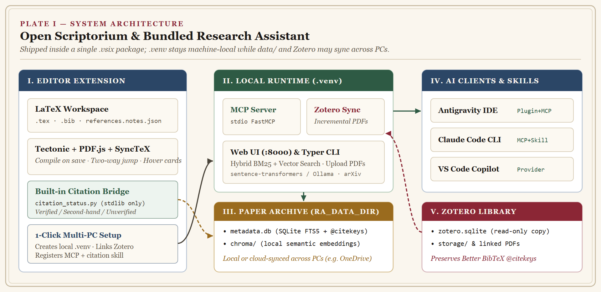

# Development, Architecture & Security

## Architecture

<p align="center">
  
</p>

See **[SETUP.md](../SETUP.md)** for full runtime directory layout (`~/.open-scriptorium/research-assistant/`) and multi-PC portability details.

---

## Branching Workflow

- **`main`** — Publishing and release branch only. Merging `dev` into `main` and pushing a matching version tag (`vX.Y.Z`) triggers `.github/workflows/release.yml`, automatically syncing the `.vsix`, `README.md`, banner, `CHANGELOG.md`, and `package.json` metadata to both the VS Code Marketplace and Open VSX Registry.
- **`dev`** — Default integration branch for ongoing development, improvements, and bug fixes.
- **`dev/<feature>`** — Feature branches created off `dev` (e.g. `dev/citation_export`) for complete new features, merged back into `dev` when ready.

---

## Building & Testing

Requires **Node.js LTS (≥ 20)** and **Python 3.10+**.

```bash
git clone https://github.com/stevieTheTurtle/open-scriptorium.git
cd open-scriptorium
npm ci
npm run build       # bundle the extension and PDF.js viewer into dist/
npm run typecheck   # TypeScript type-check
npm test            # unit tests (parsers, build queue, installer, citations, Research Assistant)
npm run package     # build a local .vsix package
```

### End-to-End Tests

The E2E suite launches an isolated VS Code instance with a clean profile and drives compile, PDF preview, and SyncTeX on a fixture project. On Windows:

```powershell
.\scripts\run-e2e.ps1 -Exe "<path to Code.exe>" -WorkDir "<empty scratch folder>" -Tectonic "<path to tectonic.exe>"
```

*Note: the extension intentionally bundles PDF.js's `legacy` build so it runs reliably across older Chromium versions shipped in VS Code.*

---

## Repository Map

| Path | Contents |
|---|---|
| `src/extension.ts` | Extension activation and command registration |
| `src/session.ts`, `src/compile.ts`, `src/tectonicInstaller.ts` | Build queue, Tectonic runner, auto-installer, diagnostics |
| `src/project.ts` | Main file discovery and output path resolution |
| `src/viewer.ts`, `src/webview/` | PDF custom editor and offline PDF.js webview (outline, search, links, tooltips) |
| `src/synctex.ts`, `src/reveal.ts` | TypeScript SyncTeX parser and exact-word matching |
| `src/editing.ts`, `src/latex.ts`, `src/bib.ts` | Completions, outline, word count, insert commands |
| `src/citationService.ts`, `src/citations.ts`, `src/citationFinder.ts`, `src/citationFinderPanel.ts` | Citation notes, status watcher, claim-support finder side panel, and bridge runner |
| `src/researchAssistant.ts`, `src/researchAssistantConfig.ts` | Setup wizard, CLI/MCP & plugin registration, warm daemon, Zotero sync, Web UI launcher |
| `research-assistant/` | Bundled Python package (`ra` CLI, `notes.py`, opt-in MCP, Zotero sync, Web UI, stdlib `citation_status.py`) |
| `agent-plugin/` | Bundled `citation-evidence` agent skill and `AGENTS.md` rules |
| `test/` | Unit tests and isolated E2E suite |

---

## Security & Privacy

- **Workspace Trust**: Compilation and Research Assistant scripts run only in [trusted workspaces](https://code.visualstudio.com/docs/editor/workspace-trust); untrusted workspaces remain read-only PDF viewers.
- **No shell-escape**: Tectonic always executes with `--untrusted`, disabling shell-escape regardless of document directives.
- **Local-only networking**: The PDF preview opens no network port (it communicates via VS Code webview messaging). The optional warm daemon and Web UI bind strictly to `127.0.0.1`.
- **Read-only Zotero access**: Zotero sync reads a temporary snapshot copy of `zotero.sqlite` and never locks or modifies your live database.
- **Zero telemetry**: No analytics or tracking. Network access occurs only when Tectonic fetches TeX packages on demand or when you explicitly invoke arXiv search.

---

## Roadmap

- [x] Citation evidence tooltips, Zotero verification states, and Find Supporting Citation (`Ctrl+Alt+C`)
- [x] Bundled Research Assistant (`ra` CLI, warm local daemon, opt-in MCP server, Zotero sync, 1-click setup)
- [x] PDF outline navigator, in-PDF search (`Ctrl+F`), and `Ctrl+Click` hyperlink navigation
- [x] Automatic Tectonic installation on first use
- [x] VS Code Marketplace & Open VSX publishing (`stevieTheTurtle.open-scriptorium`)
- [ ] Full macOS and Linux verification
