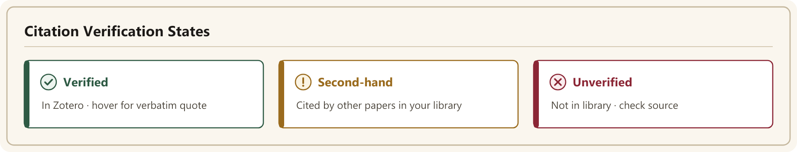

# Reference — Shortcuts, Settings & Features

Complete reference for **Open Scriptorium** commands, keyboard shortcuts, configuration settings, citation verification, and the bundled `ra` CLI.

---

## Citation Verification States

Open Scriptorium checks every `.bib` entry against your local Zotero / Research Assistant index (`metadata.db`) using a zero-dependency Python stdlib bridge (`citation_status.py`) and highlights citations directly in the PDF preview:

  

- **Verified**: Matched by Better BibTeX `@citekey` tag, normalized title + first author, or a proceedings/book chapter heading. Hovering displays paper metadata plus any verbatim quote and page number from `references.notes.json`.
- **Second-hand (amber)**: Not yet in your Zotero library, but cited by other indexed papers. Hovering lists the citing papers and extracted body-text citing phrases.
- **Unverified (crimson)**: Not indexed and not mentioned anywhere in your library. Clears automatically once the paper is added to Zotero and synced.

### Find Supporting Citation in Zotero (`Ctrl+Alt+C`)

Select any claim in a `.tex` file or the PDF preview and trigger **Find Supporting Citation in Zotero** (`Ctrl+Alt+C`, editor context menu, or floating PDF selection pill):

1. Strips LaTeX commands and PDF line-break artifacts.
2. Runs local zero-LLM hybrid recall (ChromaDB semantic + OR-based SQLite FTS5 BM25) via the warm local daemon.
3. Reranks candidates locally with a `sentence-transformers` CrossEncoder and extracts verbatim sentence-level quotes.
4. Opens a ranked side panel with one-click `\cite{key}` insertion (merging into adjacent `\cite{...}` commands) and automatic `references.notes.json` logging.

---

## Keyboard Shortcuts

| Shortcut | Action | Where |
|---|---|---|
| `Ctrl+Enter` | Compile & preview | LaTeX file or PDF tab |
| `Ctrl+Alt+Right` | Go to this location in the PDF | LaTeX file |
| `Ctrl+Alt+Left` | Go to this location in the source | PDF tab |
| `Ctrl+Alt+C` | Find Supporting Citation in Zotero | LaTeX file or PDF tab |
| Double-click | Jump to exact word in the source | PDF tab |
| `Ctrl+F` | Find text in PDF (`Enter` / `Shift+Enter`, `Esc`) | PDF tab |
| `Ctrl+Click` | Follow PDF hyperlink (URL, citation, cross-ref, TOC) | PDF tab |
| `Alt+Left` | Jump back after following an internal PDF link | PDF tab |
| `Ctrl+B` / `Ctrl+I` | Bold / italic | LaTeX file |
| `Ctrl+Scroll` | Zoom | PDF tab |

*On macOS, use `Cmd` in place of `Ctrl`. All commands are also available in the Command Palette under **Open Scriptorium**.*

---

## Settings

| Setting | Default | Description |
|---|---|---|
| `openScriptorium.mainFile` | *(empty)* | Document to compile, relative to the workspace folder |
| `openScriptorium.outDir` | `.scriptorium/build` | Folder for PDF and SyncTeX output (self-ignored in Git) |
| `openScriptorium.copyPdfTo` | *(empty)* | Also copy the compiled PDF here after a successful build |
| `openScriptorium.tectonicPath` | *(empty)* | Tectonic executable; empty uses `PATH` or `~/.open-scriptorium/bin/` |
| `openScriptorium.tectonic.autoInstall` | `true` | Auto-download Tectonic into `~/.open-scriptorium/bin/` on first compile |
| `openScriptorium.compile.trigger` | `save` | `save`, `typing`, or `off` |
| `openScriptorium.compile.typingDelayMs` | `2800` | Delay after last keystroke in `typing` mode |
| `openScriptorium.languageFeatures.enabled` | `true` | `\cite`, `\ref`, `\begin` completion and document outline |
| `openScriptorium.formatKeybindings` | `true` | `Ctrl+B` / `Ctrl+I` for bold and italic in LaTeX files |
| `openScriptorium.citations.notesFile` | *(empty)* | Path to citation evidence JSON (e.g. `01_Thesis_meta/references.notes.json`) |
| `openScriptorium.citations.statusFile` | *(empty)* | Path to citation status JSON (defaults to `<outDir>/citation_status.json`) |
| `openScriptorium.citations.statusCommand` | *(empty)* | Optional custom command to refresh citation status |
| `openScriptorium.citations.citeCommand` | `\cite` | Default command inserted by Find Supporting Citation (`\cite`, `\citep`, `\citet`, `\parencite`, `\textcite`, `\autocite`) |
| `openScriptorium.researchAssistant.enabled` | `true` | Enable bundled Research Assistant checks, CLI/MCP, and Zotero sync |
| `openScriptorium.researchAssistant.installDir` | *(empty)* | Stable install folder (defaults to `~/.open-scriptorium/research-assistant`) |
| `openScriptorium.researchAssistant.pythonPath` | *(empty)* | Optional Python 3.10+ override for citation checks and setup |
| `openScriptorium.researchAssistant.dataDir` | *(empty)* | Research Assistant `data/` folder (auto-detects OneDrive or `<installDir>/data`) |
| `openScriptorium.researchAssistant.zoteroDir` | *(empty)* | Zotero folder containing `zotero.sqlite` (auto-detected if empty) |
| `openScriptorium.researchAssistant.collection` | `Zotero` | Collection name used for citation verification and Zotero sync |
| `openScriptorium.researchAssistant.zoteroSyncIntervalMinutes` | `0` | Periodic background Zotero sync interval in minutes (`0` = manual) |
| `openScriptorium.researchAssistant.webUiPort` | `8000` | Local port for the Research Assistant Web UI and warm CLI daemon |
| `openScriptorium.researchAssistant.autoStartDaemon` | `true` | Keep the local HTTP service warm for ~50 ms `ra` CLI searches |
| `openScriptorium.researchAssistant.mcpFallback` | `false` | Also register the stdio FastMCP server for clients without shell access |
| `openScriptorium.researchAssistant.rerankerModel` | `BAAI/bge-reranker-base` | Local `sentence-transformers` CrossEncoder model for claim-support and `--rerank` scoring |

### Main File Auto-Detection

When `openScriptorium.mainFile` is empty, Open Scriptorium selects the root document in this order:
1. A `% !TEX root = ...` directive in the active file.
2. The open file itself if it contains `\documentclass`.
3. The last compiled document in the workspace.
4. A workspace search for a root `.tex` file.

---

## Bundled Features Overview

### Compilation & Writing
- **Queued Tectonic builds**: compiles on save, while typing, or on demand; requests during an active build coalesce into a single follow-up, and failed builds keep the last good PDF visible.
- **Diagnostics**: maps errors, warnings, and bad boxes to the exact source file and line in the Problems panel while keeping noisy package warnings in the log.
- **Language help**: `\cite`, `\ref`, and `\begin` completions (search citations by key, author, or title), nested document outline/breadcrumbs, status-bar word count (counting prose inside `\textbf` etc., excluding math/references), and LaTeX insert toolbar commands.

### PDF Preview & Two-Way SyncTeX
- Opens as a standard editor tab beside your source, preserving scroll position without flashing across recompiles.
- Resizable hierarchical PDF outline navigator, in-PDF search (`Ctrl+F`), `Ctrl+Click` hyperlinks with `Alt+Left` history, and VS Code theme integration (bundled offline PDF.js).
- Pure TypeScript SyncTeX engine (no external `synctex` binary required): highlights the exact typeset line from source, or double-click any word in the PDF to select that exact word in `.tex`.

### Research Assistant CLI (`ra`) & Web UI
- **Library search & reading**: `ra search "query" -k 5 --compact` (supports pushdown filters `--citekey`, `--paper-id`, `--tag`, `--author`, `--year`, `--year-from`, `--year-to`, plus `--mode hybrid|semantic|bm25`, `--semantic-weight`, `--bm25-weight`, `--rrf-k`, `--recall-k`, `--rerank`), `ra search "query" -k 8 --context`, `ra find-support "claim" -k 8` (same filters/knobs + sentence-level quote extraction), `ra chunks <paper_id|@citekey> --page N`, `ra detail <paper_id|@citekey>`, `ra list [--tag <tag>] [--year <YYYY>] --compact`, `ra add paper.pdf --tags "a,b"`, `ra status`.
- **Evidence notes & BibTeX** *(instant stdlib commands)*: `ra notes add --key <key> --quote "..." --page <N> --file "<rel.tex>" --claim "..." --paper-id "<id>"`, `ra notes get <key>`, `ra notes audit`, `ra bib get <key>`.
- **Online arXiv** *(only when explicitly requested)*: `ra arxiv search "query" -n 10`, `ra arxiv fetch <arxiv_id> [--add --tags "..."]`.
- **Web UI**: run `Open Scriptorium: Research Assistant: Open Web UI` (`http://127.0.0.1:8000`) to browse collections, upload PDFs, edit tags, and test queries.

For installation, multi-PC cloud index sharing, Zotero sync, and AI client registration (Antigravity IDE, Claude Code, VS Code), see **[SETUP.md](../SETUP.md)**.
